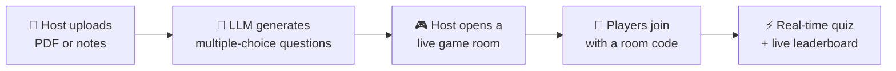
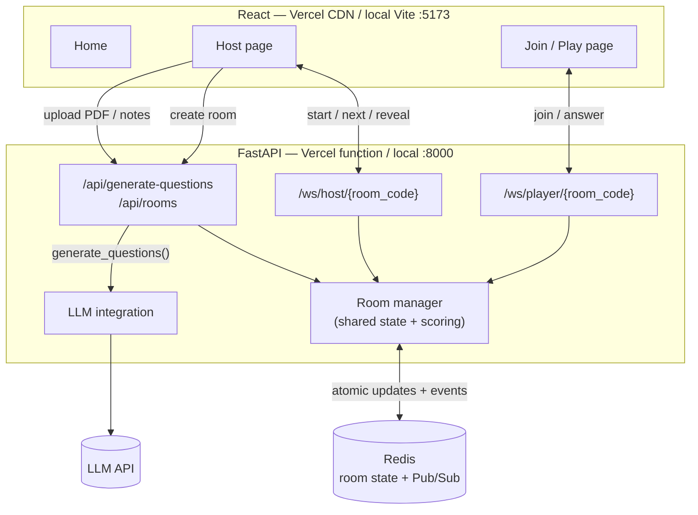

<div align="center">
  <a href="https://studywars-lime.vercel.app/">
    
  </a>

  **Turn your notes into a live, multiplayer quiz in seconds.**

  Upload a PDF or paste your notes, let AI write the questions, and host a Kahoot style
  game your friends can join from their phones.

  **[Live at StudyWars](https://studywars-lime.vercel.app/)**

  [](https://www.python.org/)
  [](https://fastapi.tiangolo.com/)
  [](https://react.dev/)
  [](https://vitejs.dev/)
  [](https://tailwindcss.com/)
  [](https://ai.google.dev/gemini-api/docs)
  [](LICENSE)

</div>

---

## Contents

- [Why I built StudyWars](#why-i-built-studywars)
- [How it works](#how-it-works)
- [Features](#features)
- [Demo](#demo)
- [Tech stack](#tech-stack)
- [Architecture](#architecture)
- [Local development](#local-development)
- [Deployment](#deployment)
- [Playing a game](#playing-a-game)
- [Testing](#testing)
- [API reference](#api-reference)
- [Project structure](#project-structure)
- [Contributing](#contributing)
- [Built by](#-built-by)
- [License](#license)

## Why I built StudyWars

My friends and I use AI a lot to study our lecture notes. It has helped me understand
mathematical theory, especially when preparing for exams. Being able to ask questions
and work through explanations at my own pace has made difficult topics easier to grasp.

But we also wanted a way to test each other and make studying together more fun. When
we come up with all the questions ourselves, we can miss questions
none of us would have thought to ask.

That's why I built StudyWars: to turn the material we're already studying into questions
we can answer together. A little competition gives us a fun way to check what we know,
spot what we need to revisit, and keep learning from each other.

## How it works



1. **Host uploads a PDF or pastes notes.**
2. **AI reads the content** and generates multiple choice questions automatically.
3. **Host reviews the questions**, opens a live game room, and shares a short join code.
4. **Players join** from their phones or laptops — no account needed.
5. **Everyone answers in real time**, and the leaderboard updates after every question.

## Features

- **AI-generated quizzes** — drop in a PDF or raw notes and choose 3, 5, 8, or 10 multiple-choice questions, powered by the LLM API. The API supports counts from 1–20.
- **Real-time gameplay** — rooms, questions, reveals, and scoring are all pushed live over WebSockets.
- **Live leaderboard** — scores update after every question so players can see where they stand.
- **No install for players** — join from any browser with a room code and a name.
- **Host controls** — start the game, reveal answers, and advance questions on your own pace.
- **Two synced views** — a big-screen host view for the room, and a lightweight player view for each device.
- **Visible countdowns** — each question has a server-enforced 20-second limit. Correct answers earn up to 1,000 points, with more points for faster answers.
- **Connection recovery** — automatically reconnect after a dropped connection, or refresh the same tab to restore your room, score, and accepted answer.
- **Persistent rooms** — Redis keeps quiz state, accepted answers, and scores across server restarts and deployments; inactive rooms expire after 24 hours.
- **Refreshed interface** — responsive host and player screens, lettered answer cards, progress indicators, connection status, and clear answer confirmations.

## Demo

[Play the live demo](https://studywars-lime.vercel.app/)

Host or join a game in your browser — no local setup needed. The demo runs on Vercel
with Upstash Redis for persistent rooms and scores. See [Playing a game](#playing-a-game)
for the host and player steps.

### Home


### Quiz setup


### Question review


### Game lobby


### Join a game


### Live questions


### Answer reveal


### Final leaderboard


## Tech stack

| Layer | Tech |
|---|---|
| Backend | Python, [FastAPI](https://fastapi.tiangolo.com/), native WebSockets, [LLM API](https://ai.google.dev/gemini-api/docs) |
| Frontend | [React](https://react.dev/) (Vite), [React Router](https://reactrouter.com/), [Tailwind CSS](https://tailwindcss.com/) |
| PDF parsing | [pypdf](https://pypi.org/project/pypdf/) |
| Realtime | WebSockets (host + player channels per room) |
| State | Redis room storage and Pub/Sub; [Upstash Redis](https://upstash.com/docs/redis/overall/getstarted) on the free deployment |
| Hosting | [Vercel](https://vercel.com/docs/frameworks/backend/fastapi) Hobby: static frontend CDN and Python functions |

## Architecture



The frontend never talks to the LLM directly. The backend generates the questions and stores
the room in Redis. Redis Pub/Sub delivers updates to connected hosts and players even when
their WebSocket connections reach different server instances. Atomic room updates prevent
concurrent answers from overwriting one another.

With Redis configured, rooms, scores, accepted answers, and deadlines survive server
restarts and deployments. Rooms expire after 24 hours of inactivity by default. On Vercel,
the backend returns an unavailable response if Redis is missing or unreachable; it never silently
switches to isolated in-memory rooms. Local development can run without Redis, but those
local rooms are lost when that process exits.

## Local development

These instructions run your own copy on your computer. To play the hosted version,
open [the live demo](https://studywars-lime.vercel.app/) instead.

### Prerequisites

- [Python 3.12](https://www.python.org/downloads/), matching CI and the Vercel runtime
- [Node.js 20.19+ or 22.12+](https://nodejs.org/) and npm, as required by [Vite](https://vite.dev/guide/)
- An [LLM API key](https://aistudio.google.com/apikey) for the configured provider
- A Redis connection for persistent rooms; optional for local development, required on Vercel

### 1. Clone the repo

```bash
git clone https://github.com/oree-xx/StudyWars.git
cd StudyWars
```

### 2. Backend setup

```bash
cd server
python -m venv venv
venv\Scripts\activate          # Windows
# source venv/bin/activate     # macOS/Linux

pip install -r requirements.txt

copy .env.example .env         # Windows
# cp .env.example .env         # macOS/Linux
```

Open `server/.env`, keep `LLM_PROVIDER=gemini`, and paste your Google AI Studio key into
`GEMINI_API_KEY`. The default model is `gemini-3.5-flash-lite`; set `GEMINI_MODEL` to use
another supported model. Requests use structured JSON output, then validate every
question and the requested count before displaying the quiz for review.

`GEMINI_KEY` is also accepted as an alias; `GEMINI_API_KEY` takes precedence if both are set.

To use the alternative provider, set `LLM_PROVIDER=anthropic`, provide `ANTHROPIC_API_KEY`,
and optionally override `ANTHROPIC_MODEL` (default: `claude-sonnet-4-6`). Only the selected
provider receives the notes; the app does not fall back to another provider automatically.

For persistent rooms, also set `REDIS_URL` to your Redis connection URL. Use the TLS TCP URL
from Upstash (`rediss://...`), not its REST URL or REST token. `ROOM_STORAGE=auto` selects
Redis when a URL is present and uses memory only for local development without one.
`ROOM_TTL_SECONDS=86400` sets the default 24-hour inactivity expiry.

Run the backend:

```bash
uvicorn app.main:app --reload
```

It starts on `http://localhost:8000`. Check it's alive at `http://localhost:8000/health`.

### 3. Frontend setup

From the repository root, in a separate terminal:

```bash
cd client
npm ci
npm run dev
```

It starts on `http://localhost:5173` and proxies `/api` and `/ws` requests through to the
backend automatically — no extra config needed.

## Deployment

### Vercel Hobby and Upstash Free

The live deployment is [studywars-lime.vercel.app](https://studywars-lime.vercel.app/).
It is connected to this repository's `master` branch for automatic deployments. The
following steps describe how to deploy your own copy.

[vercel.json](vercel.json) deploys the whole application in one Vercel project. The build
places React files in `public/` for Vercel's CDN, while [api/index.py](api/index.py) exposes
the shared FastAPI app for `/api`, `/ws`, and `/health`. Pages and live connections use
the same HTTPS domain.

1. Create an **Upstash Free** Redis database in Frankfurt, matching the function region
   `fra1`. Keep the database on Free. Copy its TLS Redis TCP URL.
2. Import `oree-xx/StudyWars` into a **Vercel Hobby** project. Use repository root `.` and
   production branch `master`; the committed configuration selects the **Other** preset,
   builds the frontend, and packages the Python function separately.
3. Add these server environment variables to Production and, if desired, Preview:

   | Variable | Value |
   |---|---|
   | `GEMINI_API_KEY` | Your Google AI Studio key |
   | `LLM_PROVIDER` | `gemini` |
   | `GEMINI_MODEL` | `gemini-3.5-flash-lite` |
   | `REDIS_URL` | The Upstash `rediss://` TCP connection URL |
   | `ROOM_STORAGE` | `redis` |
   | `ROOM_TTL_SECONDS` | `86400` |
   | `REDIS_KEY_PREFIX` | `studywars` |

4. Keep **Fluid compute** enabled, deploy, and check `/health` before hosting a quiz.
   GitHub Actions runs the repository's tests on every push; Vercel's Git integration
   builds deployments from the connected branch. Secrets stay in the server environment
   and must never use a `VITE_` prefix or be committed to Git.

The production Redis namespace stays stable across deployments. Preview deployments use
separate namespaces so their test rooms do not change production games. Changing Redis
databases or `REDIS_KEY_PREFIX` starts a separate set of rooms.

Vercel [WebSocket connections](https://vercel.com/docs/functions/websockets) follow the
[function duration limits](https://vercel.com/docs/functions/limitations), which are
300 seconds per invocation on Hobby. StudyWars renews each connection after 270 seconds;
clients reconnect automatically and restore their room from Redis, including the original
question deadline. This supports longer games
without keeping one Python process alive indefinitely. Functions can still have a cold
start, and free-plan usage limits still apply. PDF uploads are capped at 4 MiB to fit inside
Vercel's 4.5 MB total request limit; paste extracted notes for larger documents.

Upstash Free currently includes 500,000 commands per month and 10 GB monthly bandwidth;
check its [current limits](https://upstash.com/pricing/redis) for the storage allowance and
other quotas. [Adding a payment method](https://upstash.com/docs/redis/howto/upgrade-database)
switches free account resources to paid usage. Free databases may be archived after
prolonged inactivity. LLM API quotas
and pricing are separate from hosting and storage.

### Local production container

The [Dockerfile](Dockerfile) remains available for local checks or another Docker host.
It serves the built frontend and backend together. Run from the repository root:

```bash
docker build -t studywars .
docker run --rm -p 8000:8000 --env-file server/.env studywars
```

Open `http://localhost:8000`. `PORT` controls the container's listening port (default
`8000`). `FRONTEND_DIST` points to the compiled frontend and is set inside the image.
Set `REDIS_URL` in the supplied environment file to preserve rooms between containers.
The older [Render Blueprint](render.yaml) is retained for existing Docker deployments;
the Vercel project uses `vercel.json` instead.

## Playing a game

1. Open [StudyWars](https://studywars-lime.vercel.app/).
2. Click **Host a quiz**, upload a PDF with selectable text (up to 4 MiB) or paste some
   notes, choose 3, 5, 8, or 10 questions, and click **Generate my quiz**.
3. Review the generated questions, answers, and explanations, then click **Open game room**.
4. Share the six-character room code and the [join page](https://studywars-lime.vercel.app/join).
5. Players open that link on their devices or in separate browser tabs, enter the code and
   a name, then click **Let's play**.
6. Once everyone's in, the host starts the game — questions, reveals, and the leaderboard all
   sync live to every player.
7. Answer before the countdown reaches zero. The server confirms each accepted answer; a
   correct answer scores 100–1,000 points depending on speed. The host can reveal early,
   and the answer is revealed automatically when time expires or everyone has answered.

For local testing, complete [Local development](#local-development), then open
`http://localhost:5173` in separate host and player tabs. Host and players must use the
same deployment; a room created locally cannot be joined from the live demo.

Host credentials and player tokens are stored in the current tab's `sessionStorage`. A
refresh in that tab restores the current stage and remaining time; an automatic reconnect
also preserves accepted answers and scores. Closing the tab or clearing its storage loses
those credentials. Players joining with a new session must wait for a new game if the quiz
has already started. If browser storage is unavailable, refresh recovery is unavailable.

## Testing

With the backend virtual environment activated, run from `server/`:

```bash
pip install -r requirements-dev.txt
python -m unittest discover -s tests -v
```

The tests simulate both LLM providers and cover structured output, question validation,
provider errors, WebSocket recovery, scoring, deadlines, and complete host/player game flows.
They do not call the live LLM APIs or spend credits.

Redis integration tests are skipped unless `TEST_REDIS_URL` is set. To include them,
start a disposable Redis instance in another terminal (requires Docker):

```bash
docker run --rm --name studywars-test-redis -p 127.0.0.1:6380:6379 redis:7-alpine
```

In the backend test terminal, set the connection before running the test command above:

```powershell
$env:TEST_REDIS_URL = "redis://127.0.0.1:6380/0"  # Windows PowerShell
```

```bash
export TEST_REDIS_URL=redis://127.0.0.1:6380/0    # macOS/Linux
```

CI supplies Redis 7 automatically, runs these persistence tests, and checks that the
root and server dependency files match.

Run frontend checks from `client/`:

```bash
npm run lint
npm test
npm run build
```

GitHub Actions runs backend tests, frontend lint (including warnings), frontend tests,
and the production build on every push to `master` and every pull request. A separate job
builds the Docker image and checks its health endpoint and frontend pages. You can also
run the [CI workflow](.github/workflows/ci.yml) manually from the Actions tab. These checks
require no LLM API key and do not spend API credits.

For browser QA without an API key, run the sample-question backend from `server/`:

```bash
python -m uvicorn tests.browser_fixture:app --port 8000
```

Start `npm run dev` in `client/` as usual. This fixture returns sample biology questions
regardless of the supplied notes, so it is for local browser testing only. Use `app.main:app`
for the real application; do not deploy the fixture.

## API reference

### HTTP

| Method | Path | Description |
|---|---|---|
| `GET` | `/health` | App and room-storage health: returns `{"status":"ok"}` when available, or HTTP 503 if room storage is unavailable. Does not validate LLM credentials. |
| `POST` | `/api/generate-questions` | Accepts form fields `file` (PDF) or `notes`, plus `num_questions` (1–20, default 5); returns AI-generated multiple-choice questions. |
| `POST` | `/api/rooms` | Accepts JSON containing a `questions` list of 1–20 validated questions; returns a `room_code` and a `host_token`. |

PDFs must contain extractable text and be no larger than 4 MiB. Question generation uses
the first 40,000 characters of the extracted PDF text or pasted notes.

### WebSockets

| Path | Role | Notes |
|---|---|---|
| `/ws/host/{room_code}?token=...` | Host | Authenticated with the room's `host_token`. Sends `start_game`, `next_question`, `reveal_now`; receives room/player state. |
| `/ws/player/{room_code}?name=...&player_token=...` | Player | Joins the lobby with a name and an unguessable client-generated token. The same token resumes the player in any game stage. Sends `answer` with `question_index` and `option_index`; receives `answer_ack` after acceptance. |

Both sockets first receive a `room_state` snapshot and support `ping`/`pong` heartbeats.
Host commands `next_question` and `reveal_now` must include the current integer
`question_index`; missing or stale indexes are ignored.
Question events include `time_limit`, `ends_at`, and `server_time` (timestamps in milliseconds)
so countdowns can resume without granting extra time.

| Close code | Meaning | Client behavior |
|---|---|---|
| `1012` | Scheduled connection renewal on Vercel | Reconnect and restore the room |
| `1013` | Temporary storage failure or session timeout | Retry automatically |
| `4001` | Invalid credentials or an unavailable host room | Stop reconnecting |
| `4002` | Session replaced by another connection | Stop reconnecting |
| `4003` | New player joining after the game started, or a room with 100 players | Stop reconnecting |
| `4004` | Player's room is missing or expired | Stop reconnecting |

## Project structure

```
server/                FastAPI backend
  app/
    main.py             App entrypoint, CORS, router wiring
    frontend.py          Production assets and client-side routes
    config.py            Settings (.env loading)
    ai.py                LLM integration (question generation)
    pdf_utils.py          PDF text extraction
    models.py             Question schema
    rooms.py               Room state and scoring
    persistence.py         Atomic Redis storage and Pub/Sub; local memory fallback
    routers/
      questions.py          POST /api/generate-questions
      rooms.py                POST /api/rooms
      ws.py                     WebSocket endpoints (host + player)

client/                React frontend
  src/
    pages/               Home, Host, Join, Play
    components/
      host/                Setup form, lobby, live question, reveal, results
      play/                 Waiting screen, answer options, reveal
      Leaderboard.jsx        Shared leaderboard UI
    hooks/
      useGameSocket.js      WebSocket connection hook
    lib/
      api.js                REST API client
      ws.js                  WebSocket URL builders
      optionColors.js         Answer-option color mapping

.github/workflows/ci.yml  Automated tests, lint, build, and container checks
Dockerfile               Production frontend + backend image
api/index.py             Vercel Python function adapter
index.py                 Shared FastAPI deployment entrypoint
pyproject.toml / uv.lock  Python 3.12 deployment metadata and locked dependencies
requirements.txt         Vercel dependencies, kept in sync with server/requirements.txt
vercel.json              Vercel build, CDN routes, and function settings
render.yaml              Alternative Render Docker deployment
```

## Contributing

Got ideas? Contributions welcome.

1. Fork this repo
2. Create a branch: `git checkout -b feature/your-idea`
3. Commit and push
4. Open a pull request

See [open issues](https://github.com/oree-xx/StudyWars/issues) for what's being worked on.

## 👤 Built by

**Oreoluwa Oluwasina**, Actuarial science student, UNILAG 🇳🇬

[](https://github.com/oree-xx) [](https://www.linkedin.com/in/oreoluwa-oluwasina/)

## License

Distributed under the [MIT License](LICENSE).
