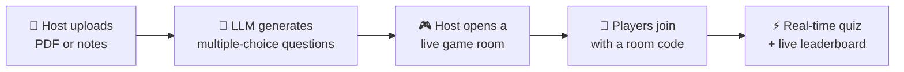
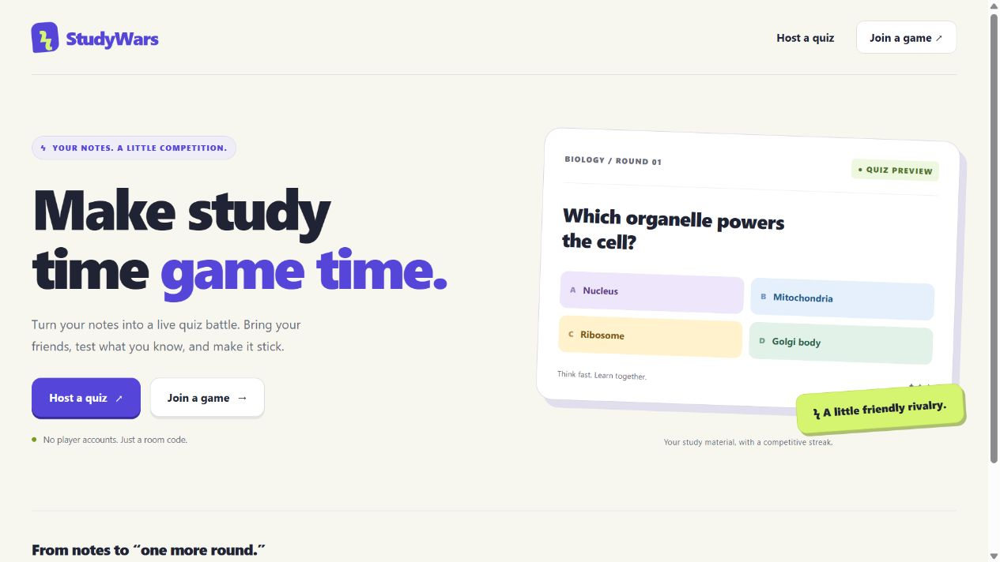
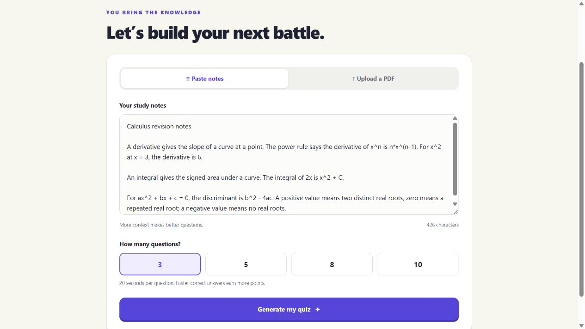
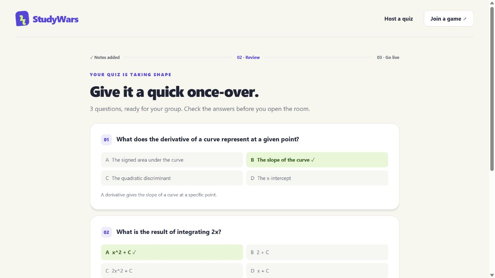
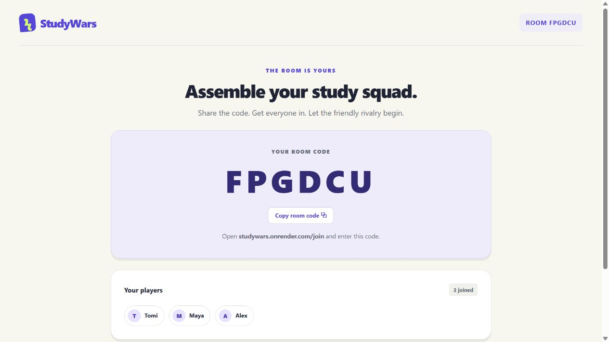
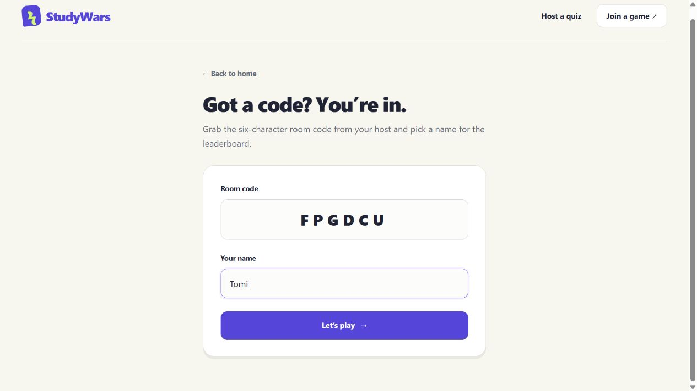
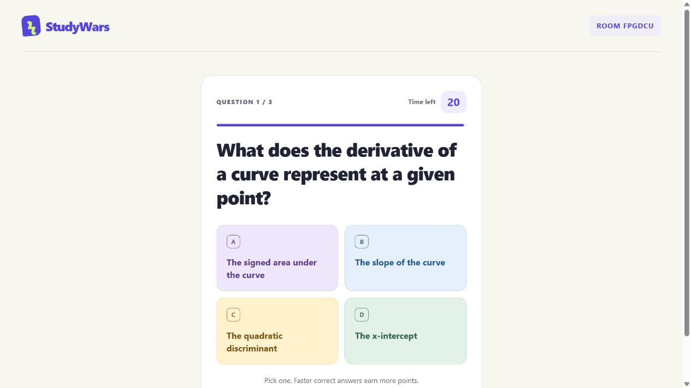
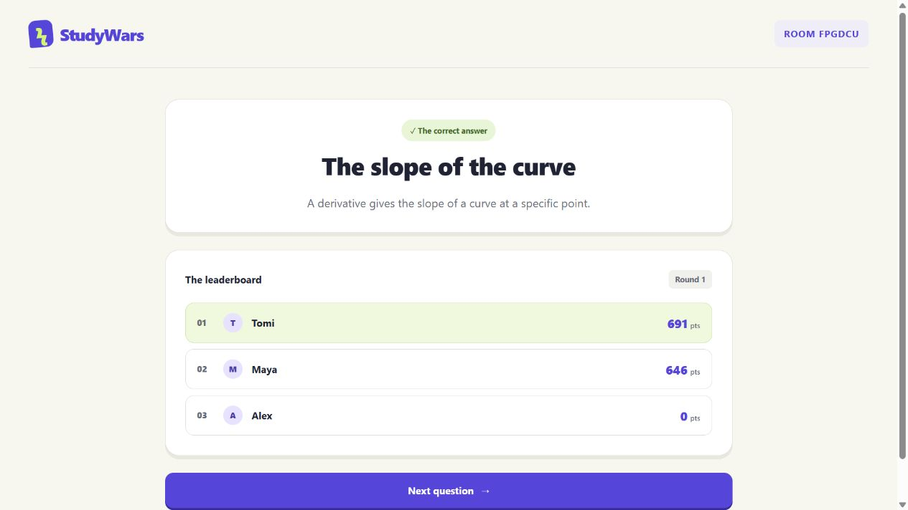
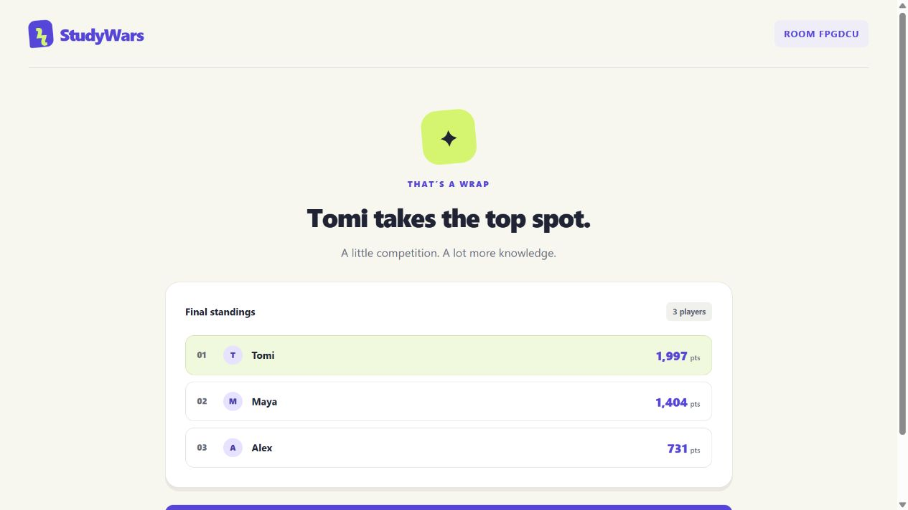
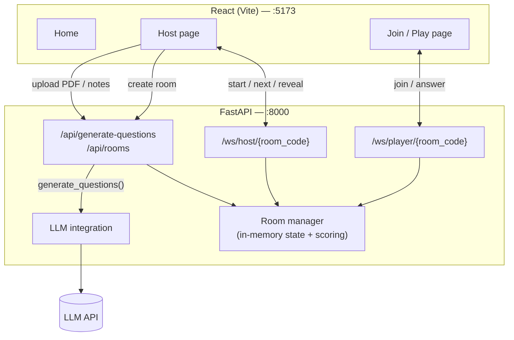

<div align="center">
  

  **Turn your notes into a live, multiplayer quiz in seconds.**

  Upload a PDF or paste your notes, let AI write the questions, and host a Kahoot style
  game your friends can join from their phones.

  [](https://www.python.org/)
  [](https://fastapi.tiangolo.com/)
  [](https://react.dev/)
  [](https://vitejs.dev/)
  [](https://tailwindcss.com/)
  [](https://ai.google.dev/gemini-api/docs)
  [](LICENSE)

</div>

---

## Contents

- [Why I built StudyWars](#why-i-built-studywars)
- [How it works](#how-it-works)
- [Features](#features)
- [Demo](#demo)
- [Tech stack](#tech-stack)
- [Architecture](#architecture)
- [Getting started](#getting-started)
- [Deployment](#deployment)
- [Playing a game](#playing-a-game)
- [Testing](#testing)
- [API reference](#api-reference)
- [Project structure](#project-structure)
- [Roadmap](#roadmap)
- [Contributing](#contributing)
- [License](#license)

## Why I built StudyWars

My friends and I use AI a lot to study our lecture notes. It has helped me understand
mathematical theory, especially when preparing for exams. Being able to ask questions
and work through explanations at my own pace has made difficult topics easier to grasp.

But we also wanted a way to test each other and make studying together more fun. When
we come up with all the questions ourselves, we can miss questions
none of us would have thought to ask.

That's why I built StudyWars: to turn the material we're already studying into questions
we can answer together. A little competition gives us a fun way to check what we know,
spot what we need to revisit, and keep learning from each other.

## How it works



1. **Host uploads a PDF or pastes notes.**
2. **AI reads the content** and generates multiple choice questions automatically.
3. **Host starts a live game room** and shares a short join code.
4. **Players join** from their phones or laptops — no account needed.
5. **Everyone answers in real time**, and the leaderboard updates after every question.

## Features

- 🧠 **AI-generated quizzes** — drop in a PDF or raw notes, get 1–20 multiple-choice questions back, powered by the LLM API.
- ⚡ **Real-time gameplay** — rooms, questions, reveals, and scoring are all pushed live over WebSockets.
- 🏆 **Live leaderboard** — scores update after every question so players can see where they stand.
- 📱 **No install for players** — join from any browser with a room code and a name.
- 🎛️ **Host controls** — start the game, reveal answers, and advance questions on your own pace.
- 🖥️ **Two synced views** — a big-screen host view for the room, and a lightweight player view for each device.
- ⏱️ **Visible countdowns** — each question has a server-enforced 20-second limit. Correct answers earn up to 1,000 points, with more points for faster answers.
- 🔄 **Connection recovery** — automatically reconnect after a dropped connection, or refresh the same tab to restore your room, score, and accepted answer.
- ✨ **Refreshed interface** — responsive host and player screens, lettered answer cards, progress indicators, connection status, and clear answer confirmations.

## Demo

<p align="center">
  
  
</p>

<p align="center">
  
  
</p>

<p align="center">
  
  
</p>

<p align="center">
  
  
</p>

## Tech stack

| Layer | Tech |
|---|---|
| Backend | Python, [FastAPI](https://fastapi.tiangolo.com/), native WebSockets, [LLM API](https://ai.google.dev/gemini-api/docs) |
| Frontend | [React](https://react.dev/) (Vite), [React Router](https://reactrouter.com/), [Tailwind CSS](https://tailwindcss.com/) |
| PDF parsing | [pypdf](https://pypi.org/project/pypdf/) |
| Realtime | WebSockets (host + player channels per room) |
| State | In-memory room/game state on the server (no database required) |

## Architecture



The frontend never talks to the LLM directly. The backend generates the questions, creates the
room, and then fans out live game state to every connected socket via the `Room` object in
`app/rooms.py`.

Rooms and scores live in one server process. Run a single backend worker: a server restart
(including a development reload) clears every room, and multiple workers do not share game
state. Browser reconnection restores a session only while its original room still exists.

## Getting started

### Prerequisites

- [Python 3.11 or 3.12](https://www.python.org/downloads/) recommended for the pinned backend dependencies
- [Node.js 20.19+ or 22.12+](https://nodejs.org/) and npm, as required by [Vite](https://vite.dev/guide/)
- An [LLM API key](https://aistudio.google.com/apikey) for the configured provider

### 1. Clone the repo

```bash
git clone https://github.com/oree-xx/StudyWars.git
cd StudyWars
```

### 2. Backend setup

```bash
cd server
python -m venv venv
venv\Scripts\activate          # Windows
# source venv/bin/activate     # macOS/Linux

pip install -r requirements.txt

copy .env.example .env         # Windows
# cp .env.example .env         # macOS/Linux
```

Open `server/.env`, keep `LLM_PROVIDER=gemini`, and paste your Google AI Studio key into
`GEMINI_API_KEY`. The default model is `gemini-3.5-flash-lite`; set `GEMINI_MODEL` to use
another supported model. Requests use structured JSON output, then validate every
question and the requested count before displaying the quiz for review.

To use the alternative provider, set `LLM_PROVIDER=anthropic`, provide `ANTHROPIC_API_KEY`,
and optionally override `ANTHROPIC_MODEL` (default: `claude-sonnet-4-6`). Only the selected
provider receives the notes; the app does not fall back to another provider automatically.

Run the backend:

```bash
uvicorn app.main:app --reload
```

It starts on `http://localhost:8000`. Check it's alive at `http://localhost:8000/health`.

### 3. Frontend setup

In a separate terminal:

```bash
cd client
npm install
npm run dev
```

It starts on `http://localhost:5173` and proxies `/api` and `/ws` requests through to the
backend automatically — no extra config needed.

## Deployment

The [Render Blueprint](render.yaml) runs a free demo service from `master`. The
[Dockerfile](Dockerfile) builds the React frontend and serves it through FastAPI, so
pages, API requests, and WebSocket connections share one HTTPS address.

1. Sign in to [Render](https://dashboard.render.com/) and choose **New > Blueprint**.
2. Connect your GitHub account and select `oree-xx/StudyWars`, branch `master`.
3. Review the free service in `render.yaml` and enter your `GEMINI_API_KEY` when prompted.
   This key belongs in Render's environment settings, never in the repository or frontend.
4. Deploy the Blueprint, then open the service's `onrender.com` address.

For subsequent pushes, **After CI Checks Pass** makes Render wait for all GitHub checks
before deploying. The workflow checks the backend, frontend, and production container.
Creating this service in your Render account is a one-time setup; committing the Blueprint
alone does not create a live deployment. See [Render's deployment docs](https://render.com/docs/deploys).

The [free service](https://render.com/docs/free) sleeps after 15 minutes without inbound
traffic and can take about a minute to wake. Rooms and scores are kept in memory, so
sleep, restarts, and redeploys clear active games. Keep one service instance and one
backend worker; the container already starts one worker. LLM API usage has its own
provider quotas and pricing, separate from hosting.

To check the same production image locally, run from the repository root:

```bash
docker build -t studywars .
docker run --rm -p 8000:8000 --env-file server/.env studywars
```

Open `http://localhost:8000`. `PORT` controls the container's listening port (default
`8000`); Render supplies its own value. `FRONTEND_DIST` points to the compiled frontend
and is set inside the image. Local development can continue using Vite as described above.

## Playing a game

1. Open `http://localhost:5173`.
2. Click **Host a Quiz**, upload a PDF or paste some notes, pick a question count, and generate.
3. Share the room code that appears in the lobby.
4. On a second device (or another browser tab), click **Join a Quiz**, enter the code and a
   name.
5. Once everyone's in, the host starts the game — questions, reveals, and the leaderboard all
   sync live to every player.
6. Answer before the countdown reaches zero. The server confirms each accepted answer; a
   correct answer scores 100–1,000 points depending on speed. The host can reveal early,
   and the answer is revealed automatically when time expires or everyone has answered.

Host credentials and player tokens are stored in the current tab's `sessionStorage`. A
refresh in that tab restores the current stage and remaining time; an automatic reconnect
also preserves accepted answers and scores. Closing the tab or clearing its storage loses
those credentials. Players joining with a new session must wait for a new game if the quiz
has already started. If browser storage is unavailable, refresh recovery is unavailable.

## Testing

With the backend virtual environment activated, run from `server/`:

```bash
pip install -r requirements-dev.txt
python -m unittest discover -s tests -v
```

The tests simulate both LLM providers and cover structured output, question validation,
provider errors, WebSocket recovery, scoring, deadlines, and complete host/player game flows.
They do not call the live LLM APIs or spend credits.

Run frontend checks from `client/`:

```bash
npm run lint
npm test
npm run build
```

GitHub Actions runs backend tests, frontend lint (including warnings), frontend tests,
and the production build on every push to `master` and every pull request. A separate job
builds the Docker image and checks its health endpoint and frontend pages. You can also
run the [CI workflow](.github/workflows/ci.yml) manually from the Actions tab. These checks
require no LLM API key and do not spend API credits.

For browser QA without an API key, run the sample-question backend from `server/`:

```bash
python -m uvicorn tests.browser_fixture:app --port 8000
```

Start `npm run dev` in `client/` as usual. This fixture returns sample biology questions
regardless of the supplied notes, so it is for local browser testing only. Use `app.main:app`
for the real application; do not deploy the fixture.

## API reference

### HTTP

| Method | Path | Description |
|---|---|---|
| `GET` | `/health` | Liveness check. |
| `POST` | `/api/generate-questions` | Accepts a PDF file (`multipart/form-data`) or `notes` text plus `num_questions` (1–20); returns AI-generated multiple-choice questions. |
| `POST` | `/api/rooms` | Creates a game room from a list of questions; returns a `room_code` and a `host_token`. |

### WebSockets

| Path | Role | Notes |
|---|---|---|
| `/ws/host/{room_code}?token=...` | Host | Authenticated with the room's `host_token`. Sends `start_game`, `next_question`, `reveal_now`; receives room/player state. |
| `/ws/player/{room_code}?name=...&player_token=...` | Player | Joins the lobby with a name and an unguessable client-generated token. The same token resumes the player in any game stage. Sends `answer` with `question_index` and `option_index`; receives `answer_ack` after acceptance. |

Both sockets first receive a `room_state` snapshot and support `ping`/`pong` heartbeats.
Question events include `time_limit`, `ends_at`, and `server_time` (timestamps in milliseconds)
so countdowns can resume without granting extra time. Close codes `4001`, `4002`, `4003`, and
`4004` indicate invalid credentials, a replaced connection, a game already in progress for a
new player, and a missing room respectively; these are terminal rather than retryable errors.

## Project structure

```
server/                FastAPI backend
  app/
    main.py             App entrypoint, CORS, router wiring
    frontend.py          Production assets and client-side routes
    config.py            Settings (.env loading)
    ai.py                LLM integration (question generation)
    pdf_utils.py          PDF text extraction
    models.py             Question schema
    rooms.py               In-memory game/room state + scoring
    routers/
      questions.py          POST /api/generate-questions
      rooms.py                POST /api/rooms
      ws.py                     WebSocket endpoints (host + player)

client/                React frontend
  src/
    pages/               Home, Host, Join, Play
    components/
      host/                Setup form, lobby, live question, reveal, results
      play/                 Waiting screen, answer options, reveal
      Leaderboard.jsx        Shared leaderboard UI
    hooks/
      useGameSocket.js      WebSocket connection hook
    lib/
      api.js                REST API client
      ws.js                  WebSocket URL builders
      optionColors.js         Answer-option color mapping

.github/workflows/ci.yml  Automated tests, lint, build, and container checks
Dockerfile               Production frontend + backend image
render.yaml              Free Render service and deployment after CI passes
```

## Roadmap

- [ ] Persist rooms/scores beyond process restarts
- [ ] Support image-based question generation (diagrams, slides)
- [ ] Exportable results (CSV / share link)

## Contributing

Issues and pull requests are welcome. If you're adding a feature, please open an issue first to
discuss what you'd like to change.

## License

Distributed under the [MIT License](LICENSE).
